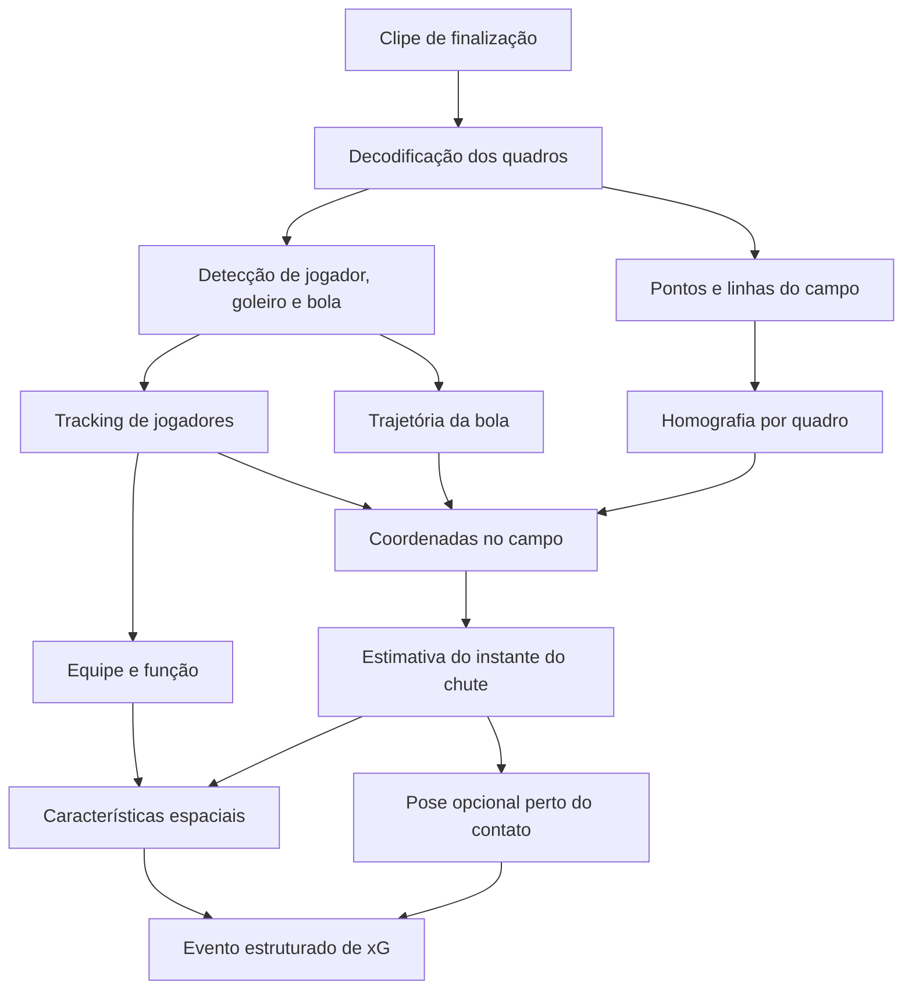

## Recorte do problema

O projeto recebe clipes nos quais a finalização já foi selecionada, portanto a primeira prova de conceito não precisa encontrar chutes ao longo de uma partida completa nem compreender todo o jogo, o objetivo é identificar os elementos e o instante do lance, localizar a finalização no campo e produzir um evento estruturado com as variáveis utilizadas pela Footstats.

Esse recorte reduz o problema a uma sequência verificável de tarefas, detecção de jogadores, goleiro e bola | rastreamento e formação de trajetórias | identificação de equipe e função | localização do campo | estimação do instante do chute | extração das características do xG.

<Callout type="idea" title="Princípio de arquitetura">

As sete categorias da Footstats não exigem sete redes neurais, várias delas podem ser calculadas por regras sobre posições, distâncias e trajetórias, o modelo deve produzir evidências visuais estáveis e as regras de negócio devem transformar essas evidências em categorias validadas com o parceiro.

</Callout>

## Pipeline inicial

Tracking e localização do campo podem ser executados em paralelo, o primeiro preserva quem ou o que se move ao longo do tempo, enquanto o segundo determina onde essas observações estão no gramado, os dois ramos se encontram no instante estimado da finalização.

Essa decomposição é compatível com o trabalho Broadcast2Pitch, publicado na WACV 2026, que alcançou resultado de estado da arte no benchmark SoccerNet-GSR por meio de uma estrutura modular com detecção, rastreamento, pontos e linhas do campo, homografia e refinamento de identidade.

## Relação entre tarefas e variáveis da Footstats

| Variável | Evidência necessária | Técnica inicial | Prioridade |
|---|---|---|---|
| Posição, distância e ângulo | finalizador, campo e instante do chute | detecção + homografia + geometria | alta |
| Parte do corpo | bola e regiões corporais no contato | pose em uma janela curta | média |
| Goleiro posicionado | goleiro, gol e ponto da finalização | coordenadas do campo + regra validada | média |
| Marcado | finalizador e adversários próximos | equipe + distâncias entre jogadores | média |
| Área ocupada | jogadores na área e no corredor do chute | contagem ou densidade em coordenadas do campo | média, com definição pendente |
| Jogada | sequência de posse anterior ao chute | trajetórias, reinício e regras temporais | média a alta |
| Assistência | sequência de toques e posses | trajetória da bola e associação jogador-bola | alta |
| Olhou antes | orientação da cabeça antes do contato | pose ou estimativa da cabeça | baixa para a PoC |

A posição da finalização deve ser a primeira entrega funcional, quando o finalizador e o campo são localizados no quadro correto, distância e ângulo passam a ser cálculos geométricos, além disso, essas grandezas criam a base para avaliar marcação, área ocupada e posicionamento do goleiro.

<Callout type="warn" title="Definições que dependem do parceiro">

Visão computacional pode medir a distância do goleiro ao gol, a proximidade do defensor ou o número de jogadores em uma região, porém não define sozinha qual limite significa goleiro posicionado, jogador marcado ou área ocupada, esses critérios devem ser formalizados com a Footstats antes de serem tratados como rótulos objetivos.

</Callout>

## Decisões para a primeira PoC

### 1. Detector

O primeiro experimento deverá treinar ou ajustar YOLOv8n e YOLO26n com a mesma amostra anotada, mesma resolução e mesma divisão de treino e validação, o YOLOv8n será o controle sustentado por uso consolidado e evidência específica em futebol, enquanto o YOLO26n será o candidato atual orientado à borda.

O projeto não deverá assumir uma migração automática do YOLOv8 para o YOLO26, se o modelo atual demonstrar vantagem clara desde o início, ele poderá seguir como base, se o YOLOv8 apresentar melhor detecção da bola ou menor risco de integração, ele poderá permanecer até que uma nova comparação justifique a troca.

### 2. Tracking

O ByteTrack será utilizado primeiro por oferecer uma integração simples e tentar recuperar objetos associados a detecções de menor confiança, caso os movimentos de câmera e as trocas de identidade causem erros relevantes, o BoT-SORT deverá ser testado como alternativa por incorporar informação de aparência e compensação do movimento da câmera.

A trajetória da bola deverá ter validação separada, com rejeição de saltos improváveis, interpolação apenas em lacunas curtas e registro explícito de períodos sem observação, pois inventar uma trajetória longa pode produzir um instante de chute aparentemente estável, mas incorreto.

### 3. Localização no campo

Um detector de pontos-chave e, posteriormente, de linhas do campo deverá fornecer correspondências para estimar a homografia, a transformação deverá ser atualizada nos quadros relevantes porque movimentos de câmera, zoom e troca de enquadramento alteram a relação entre pixel e posição no gramado.

A posição inicial do finalizador poderá usar o centro inferior da caixa do jogador, ponto que aproxima o contato com o chão, já a bola não deverá ser projetada indiscriminadamente após o chute porque a homografia representa o plano do gramado e não a trajetória aérea.

### 4. Instante da finalização

Como o clipe já contém um chute, o instante de contato poderá ser estimado inicialmente por uma função simples que combine proximidade jogador-bola, alteração da velocidade, mudança de direção e afastamento da bola após o contato, pesquisa de 2025 sobre detecção de último toque demonstra que sinais cinemáticos e de proximidade podem formar um baseline útil, embora os dados usados no estudo sejam mais precisos que o vídeo disponível no projeto.

### 5. Extração gradual das características

As características serão desenvolvidas em três níveis, o primeiro cobre posição, distância e ângulo | o segundo cobre parte do corpo, marcação, ocupação da área e goleiro posicionado | o terceiro cobre assistência completa e direção do olhar, essa ordem evita que categorias subjetivas ou dependentes de contexto bloqueiem a validação do núcleo espacial.

## Hipóteses e métricas para as próximas sprints

| Hipótese | Teste | Métrica principal |
|---|---|---|
| H1, um YOLO leve detecta os objetos críticos | comparar YOLOv8n e YOLO26n nos clipes reais | mAP por classe e recall da bola perto do contato |
| H2, pontos do campo produzem posição útil | comparar a posição automática com marcação manual | erro espacial em metros |
| H3, cinemática localiza o chute | comparar quadro previsto com contato anotado | erro temporal em quadros |
| H4, regras espaciais aproximam categorias humanas | comparar regras e rótulos da Footstats | precisão, recall e matriz de confusão |
| H5, pose só é necessária em variáveis corporais | comparar parte do corpo com e sem pose | acurácia e custo adicional |
| H6, o pipeline cabe no dispositivo de borda | executar cada estágio no hardware definido | latência, FPS, RAM, VRAM e energia |

Além da média geral do detector, deverá ser registrada uma métrica orientada ao evento, a porcentagem de finalizações nas quais bola e finalizador estão corretamente disponíveis dentro de uma janela de quadros ao redor do contato, essa medida representa melhor a utilidade do sistema, pois uma detecção perdida no momento decisivo pode impedir todas as etapas seguintes.

Também deverá ser medido o acordo entre anotadores humanos para categorias como marcado, área ocupada e olhou antes, quando a referência humana varia, o desempenho do modelo precisa ser interpretado em relação a essa variabilidade e não como simples comparação com um rótulo absoluto.

## Riscos e respostas iniciais

| Risco | Impacto | Resposta inicial |
|---|---|---|
| bola pequena, rápida ou borrada | quebra da trajetória e do instante do chute | maior resolução, ajuste com dados reais e suavização temporal |
| oclusão na área | perda de bola ou troca de identidade | tracker, histórico e interpolação curta |
| câmera móvel e zoom | posições inconsistentes no campo | homografia atualizada ao longo do clipe |
| diferença entre datasets públicos e Footstats | queda de qualidade no cenário real | amostra anotada do parceiro e ajuste fino |
| categorias subjetivas | referência inconsistente | definição formal e análise de concordância humana |
| clipe sem contexto anterior | assistência e jogada não observáveis | requisito mínimo de duração antes do chute |
| muitos modelos executados em sequência | aumento de latência e memória | ativação seletiva, como pose somente perto do contato |

## Decisão consolidada

<Callout type="success" title="Direção para a Sprint 2">

A primeira PoC adotará uma arquitetura modular, comparará YOLOv8n e YOLO26n para detectar jogador, goleiro e bola, utilizará ByteTrack como tracker inicial, pontos do campo e homografia para converter pixels em coordenadas, além de uma heurística cinemática para estimar o contato, a entrega inicial priorizará posição, distância e ângulo, enquanto as demais variáveis serão incorporadas conforme qualidade dos dados, custo computacional e clareza das definições da Footstats.

</Callout>

Essa decisão representa uma hipótese de engenharia e não uma arquitetura definitiva, seu valor está em produzir componentes mensuráveis e permitir que cada escolha seja mantida, substituída ou simplificada com base nos testes do projeto.

O contexto das famílias de modelos e dos critérios de comparação pode ser consultado em [Modelos e tarefas de visão computacional](./modelos-visao-computacional).

## Referências

1. OO, Yin May et al. [Broadcast2Pitch: Game State Reconstruction from Unconstrained Soccer Videos](https://openaccess.thecvf.com/content/WACV2026/html/Oo_Broadcast2Pitch_Game_State_Reconstruction_from_Unconstrained_Soccer_Videos_WACV_2026_paper.html). WACV, 2026.
2. CIOPPA, Anthony et al. [SoccerNet-Tracking: Multiple Object Tracking Dataset and Benchmark in Soccer Videos](https://openaccess.thecvf.com/content/CVPR2022W/CVSports/html/Cioppa_SoccerNet-Tracking_Multiple_Object_Tracking_Dataset_and_Benchmark_in_Soccer_Videos_CVPRW_2022_paper.html). CVPR Workshops, 2022.
3. THEINER, Jonas; EWERTH, Ralph. [TVCalib: Camera Calibration for Sports Field Registration in Soccer](https://openaccess.thecvf.com/content/WACV2023/html/Theiner_TVCalib_Camera_Calibration_for_Sports_Field_Registration_in_Soccer_WACV_2023_paper.html). WACV, 2023.
4. WANG, Henry et al. [Semi-automated Last Touch Detection for Out-of-Bounds Possession Decisions in Football](https://link.springer.com/article/10.1007/s12283-025-00518-3). Sports Engineering, 2025.
5. YEUNG, Calvin; IDE, Kenjiro; FUJII, Keisuke. [AutoSoccerPose: Automated 3D Posture Analysis of Soccer Shot Movements](https://openaccess.thecvf.com/content/CVPR2024W/CVsports/html/Yeung_AutoSoccerPose_Automated_3D_Posture_Analysis_of_Soccer_Shot_Movements_CVPRW_2024_paper.html). CVPR Workshops, 2024.
6. OPENCV. [Features2D + Homography to Find a Known Object](https://docs.opencv.org/4.12.0/d7/dff/tutorial_feature_homography.html). Documentação oficial, acesso em 13 ago. 2026.
